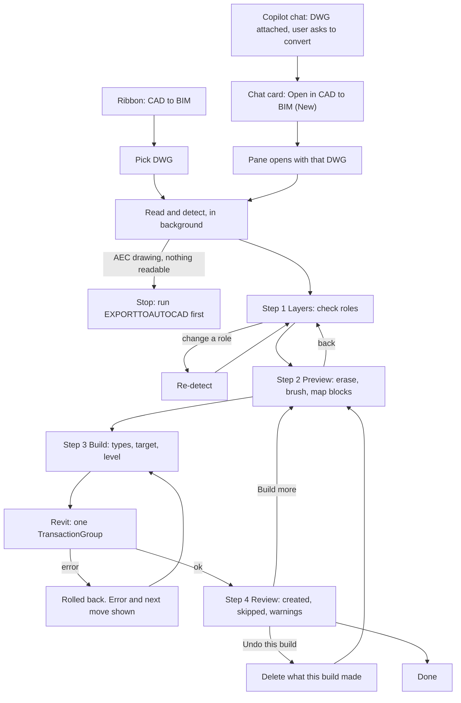

# CAD to BIM: a better flow (AI-344)

Date: 2026-11-12. Status: draft for review with Ashraf. Design only, no code yet.
Base: `origin/develop` at `d2bf39d7`. Every "today" statement below has a file:line on that commit.
Anything marked **New** does not exist yet.

## 1. Summary

Today the pane does the hard part well: it reads the DWG, shows a preview, lets the user erase and brush walls, and builds in one undo step. What is weak is around it:

- Layer roles are a click-to-cycle chip with four states, and each click re-reads the whole DWG.
- The Opening role does not decide windows. A settings word list does.
- After the build the user gets one status sentence. Skip reasons are partly wrong, some skips are silent, and undo can leave the pane out of step with the model.
- The Copilot chat has its own, separate CAD tools with a different engine. It never uses the pane.

The proposal:

1. One flow in four steps: **Layers → Preview → Build → Review**. The preview stays on screen the whole time; only the right column changes.
2. More layer roles: Wall, Door, Window, Electrical (**New**, AI-346), Other, Skip. Picked from a dropdown, with the reason for each guess shown.
3. A **Review** step that lists what was created, what was skipped and why, warnings, and an "Undo this build" button.
4. The pane is the only place that builds a whole plan. The chat starts it ("Open in CAD to BIM") and hands over the DWG.

## 2. Today on develop vs proposed

| Area | Today on develop | Proposed |
|---|---|---|
| Start | Ribbon button → file dialog → pane (`Commands/OpenCadToBimCommand.cs:39-85`, `:103-110`). "Change…" in the pane (`UI/CadToBim/CadToBimPanel.xaml.cs:169-178`). | Same. Plus **New**: chat card "Open in CAD to BIM" with the attached DWG. |
| Steps | One long sidebar: Drawing, Layers, Walls, Plans on sheet, Will be built, Put the result (`CadToBimPanel.xaml:126-258`). | **New**: four steps in the same 258 px column. Viewport unchanged. |
| Layer roles | Four states: `WALL`, `OPEN`, `SKIP`, `—` (`UI/CadToBim/CadToBimViewModel.cs:23`, `:48-59`). | Wall, Door, Window, Electrical, Other, Skip. |
| How a role is guessed | Layer name contains a hint word (`Services/CadToBim/CadToBimSettings.cs:34-48`, `CadToBimViewModel.cs:954-966`). No reason shown. | Same name hints, plus a content check, plus a one-line reason under the chip. |
| Fixing a wrong guess | Click the chip to cycle Wall → Open → Skip → — (`CadToBimViewModel.cs:464-478`). Every click re-reads the DWG (`:477` → `Redetect` → `OpenAsync`). Not saved. | Dropdown. One re-detect per change. **New**: remember overrides per drawing. |
| Windows | Window marks come from layers matching `WindowLayerHints`, not from the role chip (`CadToBimViewModel.cs:928-931`, `CadToBimSettings.cs:40`). | The Window role decides it. Hints only make the first guess. |
| Preview fixes | Erase a wall, Brush missed walls (`CadToBimPanel.xaml:67-80`). Doors/windows cannot be removed one by one. | Same, plus **New**: click a door/window/electrical point to leave it out. |
| Types used | First basic wall type for every wall (`Services/CadToBim/Cad2BimBuilder.cs:360-364`). First door and first window type by name (`:480-481`, `:516-522`). | **New**: wall type per thickness band, chosen door/window types (AI-345). Block → family table for electrical (AI-346). |
| Electrical | Not in the pane. The pane engine flattens blocks and drops their names (`Cad2Bim/cad2bim/Services/CadRenderSource.cs:35-39`, `:582-611`). | **New** role and block mapping (section 5). |
| Build target | "Add to this project" on a level (default) or "Save as new .rvt beside the drawing" (`CadToBimViewModel.cs:239`, `CadToBimPanel.xaml:244-253`). After a new-file build the target flips to Add (`CadToBimViewModel.cs:715-716`). | Same. |
| After the build | One status sentence (`CadToBimViewModel.cs:718-732`). | **New**: Review step (section 6). |
| Undo | One `TransactionGroup("CAD to BIM")` → one Ctrl+Z (`Cad2BimBuilder.cs:96-97`, `:171`). The pane keeps its "already built" list after Ctrl+Z (`CadToBimSession.cs:44-47`, `:101-102`). | Same group, plus **New** "Undo this build" button, and the pane drops undone walls from its list. |
| Chat | Separate tools: `cad_walls_from_attachment`, `cad_doors_from_attachment`, `cad_windows_from_attachment` (`BinaVibe/Mcp/Tools/ToolRegistry.cs:57-59`). Different engine (`CadWallsFromAttachment.cs:7-11`). Never opens the pane. | Chat hands whole-plan jobs to the pane (section 7). |

## 3. Flow



Rules:

- The viewport stays on screen in every step. Only the right column changes.
- The step bar is clickable. Going back never loses erase, brush or mapping work (today `CarryForwardFrom` already keeps erase and brush across a re-detect, `CadToBimSession.cs:138-145`).
- Nothing is built before step 3's Build button. Same promise as today's empty state (`CadToBimPanel.xaml:62`).

## 4. Screens

Right column is 258 px today (`CadToBimPanel.xaml:51`), about 38 characters at the pane's 12 px font. Mockups are drawn at that width. The viewport is to the left and is not drawn except in 4.2.

### 4.1 Step 1: Layers

```
+--------------------------------------+
| [1 Layers] 2 Preview 3 Build 4 Review|
+--------------------------------------+
| DRAWING                      Change… |
| L1-PLAN.dwg                          |
| 1 unit = 1 mm · header               |
| 0.84 s · 21,406 entities             |
+--------------------------------------+
| LAYERS            18 · 2 need a look |
| [x] A-WALL      412  [Wall       v]  |
|       name has "wall"                |
| [x] A-DOOR       38  [Door       v]  |
|       name has "door" · 36 swings    |
| [x] A-GLAZ       54  [Window     v]  |
| [x] E-LIGHT     120  [Electrical v]  |
|       120 blocks, 3 block names      |
| [x] 0           903  [Other      v] !|
|       903 lines, no hint matched     |
| [ ] FURN         77  [Skip       v]  |
|       excluded: FURN*                |
| [x] A-WALL-EXT    0  [Wall       v] !|
|       wall layer, no walls found     |
+--------------------------------------+
| [ Next: Preview  ]                   |
+--------------------------------------+
```

- Checkbox = show/hide in the viewport only (same as today, `CadToBimPanel.xaml:156-157`).
- Click a layer name: **New** "solo" that layer in the viewport so the user can see what it holds.
- `!` = "need a look". Shown when a layer with many entities is Other, or a Wall layer gives no walls. Sorted to the top.

### 4.2 Step 2: Preview

```
+--------------------------------------+--------------------------------------+
| [Pan][Erase][Brush][Pick]            | 1 Layers [2 Preview] 3 Build 4 Review|
|                                      +--------------------------------------+
|   ====||========  ====               | WILL BE BUILT                        |
|   ||  door)    ||    ||  o o o       | Walls 212   Doors 36   Windows 54    |
|   ||   ROOM 1  ||    ||  o o o       | Rooms 14    Erased 3   Brushed 5     |
|   ====---====== ======               | Lights 86   Power 40   Switches 22   |
|                         o = light    | DBs 0                                |
|                                      +--------------------------------------+
|                                      | ELECTRICAL BLOCKS      4 names       |
|                                      | LIGHT-DL   86  [Downlight 600   v]   |
|                                      | SSO-13A    40  [Twin socket 13A v]   |
|                                      | SW-1G      22  [1 gang switch   v]   |
|                                      | DB-MAIN     1  [Not mapped      v]  !|
|                                      |  1 block not mapped: listed, not     |
|                                      |  built. Pick a family to include it. |
|                                      +--------------------------------------+
| ! 6 wall-layer lines not paired      | [ Back ]      [ Next: Build ]        |
+--------------------------------------+--------------------------------------+
```

- Erase and Brush work as today (`CadToBimViewModel.cs:454-462`, `:524-599`).
- **New** Pick tool: click a door, window or electrical point to leave it out. Click again to bring it back. Same toggle idea as Erase.
- The electrical table appears only when a layer has the Electrical role. Same table shape is used for door and window block names when AI-345 adds block-based doors.

### 4.3 Step 3: Build

```
+--------------------------------------+
| 1 Layers 2 Preview [3 Build] 4 Review|
+--------------------------------------+
| WALLS                                |
| Thickness  50 - 400 mm               |
| Height     3000 mm                   |
| TYPES                                |
| 100-150 mm  [Generic - 125 mm   v]   |
| 200-250 mm  [Brick - 230 mm     v]   |
| Door        [Single 900x2100    v]   |
| Window      [Fixed 1200x1200    v]   |
+--------------------------------------+
| PLANS ON SHEET              2 found  |
| (o) Stack as storeys (Level 1, 2, …) |
| ( ) Keep drawing position, one level |
+--------------------------------------+
| PUT THE RESULT                       |
| (o) Add to this project              |
|     [Level 1                    v]   |
| ( ) Save as new .rvt beside DWG      |
|                                      |
| Will create 1 new level: CAD Level 2 |
| [ Build 212 walls + 236 more ]       |
+--------------------------------------+
```

- Thickness, height, storeys and target are today's controls, moved here (`CadToBimPanel.xaml:170-257`).
- TYPES is **New** (AI-345). Today every wall gets the first basic wall type.
- "Will create 1 new level" is **New**. Today `LevelFor` makes "CAD Level N" levels without warning (`Cad2BimBuilder.cs:302-351`).

### 4.4 Step 4: Review

```
+--------------------------------------+
| 1 Layers 2 Preview 3 Build [4 Review]|
+--------------------------------------+
| Built in 4.2 s on Level 1, Level 2   |
| CREATED                     Select   |
|  Walls      210                      |
|  Doors       33                      |
|  Windows     52                      |
|  Rooms        8                      |
|  Lights      86                      |
|  Power       40                      |
|  Switches    22                      |
+--------------------------------------+
| SKIPPED (13)          click to find  |
| > 2 walls    centreline too short    |
| > 2 doors    host wall not built     |
| > 1 door     narrower than 300 mm    |
| > 2 windows  Revit would not place   |
| > 6 rooms    Level 2 has no plan view|
| > 1 DB       DB-MAIN not mapped      |
+--------------------------------------+
| WARNINGS (2)                         |
| ! New level made: CAD Level 2        |
| ! 3 walls erased in preview          |
+--------------------------------------+
| UNDO                                 |
| [ Undo this build ]                  |
| or Ctrl+Z once in Revit              |
| [ Build more ]           [ Done ]    |
+--------------------------------------+
```

Details are in section 6.

## 5. Layer roles

| Role | First guess (auto-detect) | What it builds | Status |
|---|---|---|---|
| Wall | Name has a wall hint: wall, dinding, tembok, partition, bata (`CadToBimSettings.cs:34`). **New** check: flag if it gives no wall pairs. | Walls from paired lines (`CadToBimViewModel.cs:836-867`). | Today |
| Door | Name has door, pintu. **New** check: arcs in the door swing range, 500-1500 mm (`CadToBimSettings.cs:28-29`). | Doors from swing arcs (`CadToBimViewModel.cs:931`). | Today as part of Opening; split is **New** |
| Window | Name has win, window, tingkap, glaz, wdw (`CadToBimSettings.cs:40`). | Windows from marks on wall centrelines (`CadToBimViewModel.cs:928-931`). | Today as part of Opening; split is **New** |
| Electrical | **New**. Name hints to agree (for example elec, light, lampu, power, soket, suis, DB). Check: the layer is mostly block inserts. | One family instance per block insert, from the block → family table. Unmapped block names are listed, never guessed. | **New**, AI-346 |
| Other | No hint matched. | Nothing. Text on it can still name rooms (`Cad2Bim/cad2bim/ModelSource.cs:30-44`). Read for walls only when no layer is Wall (`CadToBimViewModel.cs:842-858`). | Today (shown as `—`) |
| Skip | Matches an exclude glob: PERABUT, FURN*, SANI*, GRID*, … (`CadToBimSettings.cs:44-48`). | Nothing. Not read at all, text included (`CadToBimViewModel.cs:936-951`). | Today |

How a user fixes a wrong guess:

1. Open the dropdown on the layer and pick the right role. One re-detect runs. Today a click cycles one step and re-reads the DWG each time, so Other → Skip takes three re-reads.
2. The reason line changes to "set by you". **New**: the choice is remembered for this drawing, so reopening the DWG keeps it. Today `_roles` lives only in memory (`CadToBimViewModel.cs:142`).
3. If a layer mixes things (walls and doors on layer `0`), roles cannot fix it. The user uses Erase, Brush and Pick in step 2. That is the existing answer for bad layering (`docs/superpowers/specs/2026-09-08-cad-to-bim-pane-design.md:159`).
4. Wrong electrical mapping: change the family in the step 2 table. Mapping is by block name, so one change fixes every insert of that block.

## 6. After the build: Review

**Created.** Counts per kind. "Select" selects them in Revit. **New**: needs the builder to record every created id. Today `BuildReport` records only wall ids (`Services/CadToBim/BuildReport.cs:36`); doors, windows and rooms are counts only (`:13-16`).

**Skipped, with reasons.** Each line is clickable and zooms the viewport to those items, marked red. Today's gaps:

| What | Today | Problem |
|---|---|---|
| Walls | `SkippedWalls` for too-short centrelines, a level that could not be made, or a Revit failure (`Cad2BimBuilder.cs:112-117`, `:134-143`, `:442-447`). | Status says "centreline too short" for all of them (`CadToBimViewModel.cs:722-723`). |
| Doors and windows | One `SkippedOpenings` count for four reasons: no family, no host wall, narrower than 300 mm, Revit refused (`Cad2BimBuilder.cs:486-511`). | Status says "no door/window family in the template" for all of them (`CadToBimViewModel.cs:724-725`). Often wrong. |
| Rooms | Counted only when the level has no plan view (`Cad2BimBuilder.cs:549-553`). | Rooms with a short outline or a Revit failure are dropped with no count (`:560`, `:574`, `:592-595`). |

**New**: the report keeps one list per reason, with the CAD position of each item, so the Review can name the reason and find the item.

**Warnings.** Things that were built but may surprise the user: new levels made, one wall type used for all thicknesses (until AI-345), walls erased in the preview, unpaired wall lines (today's footer, `CadToBimViewModel.cs:767-769`), AEC entities skipped (`:449`).

**Undo.**

- Today the build is one `TransactionGroup("CAD to BIM")`, assimilated into one undo step (`Cad2BimBuilder.cs:96-97`, `:171`). Ctrl+Z once removes it all. A failed build is rolled back (`:226-242`). Keep this.
- Problem today: after Ctrl+Z the pane still thinks those walls are built (`CadToBimSession.cs:44-47`, `Pending` at `:101-102`). "Confirm" then says there is nothing new to build.
- **New** "Undo this build" button: deletes the ids this build recorded, in one transaction, and clears them from the pane. Works even after the user did other edits, which Ctrl+Z does not.
- **New** before each build: drop ids from the "already built" list that are no longer in the model. The builder already collects the walls present in the model (`Cad2BimBuilder.cs:176-180`).
- New .rvt target: the file is saved and opened (`Cad2BimBuilder.cs:187-219`), so there is nothing to undo in the original project. Review says "Close and delete <name>.rvt to discard". See open question 4.

## 7. Panel vs Copilot chat

**Recommendation: the pane runs the flow. The chat starts it and hands over the DWG. Both entry points use the same four steps and the same engine.**

How it works (**New**): when a DWG is attached and the user asks to convert the plan, the chat shows a card "Open in CAD to BIM". The card opens the pane and calls `OpenAsync` on that path, the same way the ribbon command does (`OpenCadToBimCommand.cs:46-85`, pane reachable through `App.CadToBimPaneHost`, `App.cs:62`). Optional: after the build the pane posts the Review counts back into the chat.

Reasons:

1. **Two engines give two answers today.** The pane uses the Cad2Bim classifier (`CadToBimViewModel.cs:860-867`). The chat tools use `CadCenterlineSolver` on ACadSharp lines (`BinaVibe/Mcp/Tools/CadWallsFromAttachment.cs:7-11`). The same DWG can give different walls depending on where the user started.
2. **The preview needs room.** Erase, Brush, layer solo and the block table need the viewport. A chat card cannot hold them.
3. **One undo step and one review.** Each chat tool opens its own transaction (`CadWallsFromAttachment.cs:186`, `CadDoorsFromAttachment.cs:187`), so a full plan is three or more undo steps, with no rooms and no review.
4. **The chat has good parts to borrow, not to keep separate:** preview before create (`create=false`, `CadDoorsFromAttachment.cs:121-165`), thickness → wall type bands (`CadWallBanding.cs:24`), block name → type mapping with skip counts (`CadDoorsFromAttachment.cs:254-255`), and block names read from the DWG (`CadFileReader.cs:197`).

The earlier spec left "Copilot chat driving CAD to BIM" out of scope (`docs/superpowers/specs/2026-09-08-cad-to-bim-pane-design.md:154`). This proposal keeps that: the chat does not drive the build, it only opens the pane.

## 8. What code changes (rough)

| Change | Where | Size | Task |
|---|---|---|---|
| Role enum: Wall, Door, Window, Electrical, Other, Skip. Dropdown instead of cycle. Reason text. | `CadToBimViewModel.cs:23-61`, `:464-478`, `:954-966`; `CadToBimPanel.xaml:158` | S | AI-345 |
| Window marks from the Window role, not only from hints | `CadToBimViewModel.cs:928-931` | S | AI-345 |
| Remember role overrides per drawing | `CadToBimSettings.cs` (new key), `CadToBimViewModel.cs:142` | S | AI-345 |
| Four-step sidebar | `CadToBimPanel.xaml:122-258`, view model step state | M | AI-345 |
| Pick tool: leave out one door/window/point | `CadOverlayViewport.cs:23`, `CadToBimSession.cs` | S | AI-345 |
| Wall type per thickness band, chosen door and window types | `Cad2BimBuilder.cs:360-364`, `:480-481`; reuse `CadWallBanding` | M | AI-345 |
| Read block inserts (name, point, rotation, layer) in the pane engine | `CadRenderSource.cs:35-39`, `:582-611`; or reuse `CadFileReader.cs:197` | M | AI-346 |
| Block → family table, saved; unmapped listed | view model + `CadToBimSettings.cs` | M | AI-346 |
| Place electrical family instances | `Cad2BimBuilder.cs` (new step after openings), `BuildTypes.cs` | M | AI-346 |
| Report: one list per skip reason, with CAD positions; all created ids | `BuildReport.cs`, `Cad2BimBuilder.cs:486-511`, `:549-595` | M | AI-345 |
| Review step and "Undo this build" | `CadToBimViewModel.cs:683-733`, new external event handler | M | AI-345 |
| Prune "already built" after Ctrl+Z | `CadToBimSession.cs:101-102`, `Cad2BimBuilder.cs:176-180` | S | AI-345 |
| Chat card "Open in CAD to BIM" | `UI/Copilot/CopilotViewModel.cs:981-1022` area | S | separate |

S = about a day, M = a few days. Order: report and review first (they show the effect of every later change), then roles, then electrical.

## 9. Open questions for Ashraf

1. Pane builds, chat only opens the pane: agreed? Do we retire `cad_walls/doors/windows_from_attachment` later, or keep them for small jobs ("only the walls on A-WALL-EXT")?
2. Electrical: which layer hint words, and which family library do we map to? Is the block → family table per user or per project?
3. Electrical heights: a plan has none. Use a default mounting height per family type, or read it from block attributes?
4. "Save as new .rvt" undo: only tell the user to delete the file, or offer a "Close and delete" button?
5. Split Opening into Door and Window: agreed? Keep both Other and Skip, or merge them?
6. New levels from "Stack as storeys" have no plan view, so their rooms are skipped (`Cad2BimBuilder.cs:549-553`). Should the build also create a plan view for each new level?
7. Is "Undo this build" worth the work, or is Ctrl+Z plus the prune fix enough for now?

## 10. Notes on the Linear task text

- "Each DWG layer gets one role: Wall, Opening or Skip … Nothing else can be picked." There is a fourth state, `—` (Other), and the chip cycles through all four (`CadToBimViewModel.cs:23`, `:57`, `:472-473`). Also, the Opening role does not decide windows: the window hint list does (`:928-931`).
- `CadToBimViewModel.cs:671` is the `_raiser.Raise()` call. The method that builds the request is `Confirm()` at `:603`. The other two refs are right.
- The earlier spec says a failed save "stays in the unsaved document, pane offers Save As" (`2026-09-08-cad-to-bim-pane-design.md:70`). The code rolls back and closes the new document instead (`Cad2BimBuilder.cs:194-201`, `:226-242`).
- Electrical from DWG blocks needs block names. The pane engine does not keep them today (section 5), so AI-346 starts with a block reader.
